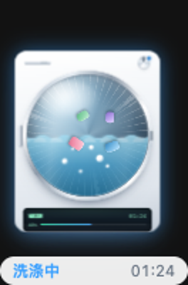
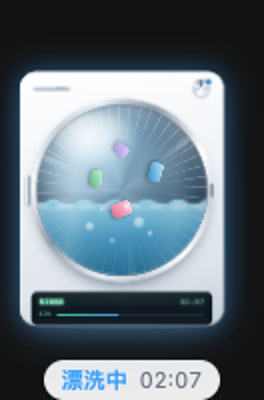
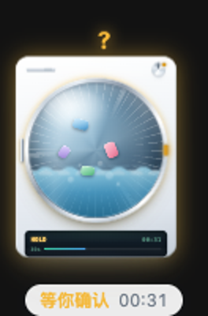
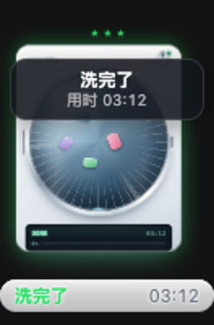

# dsh-washer · 滚筒洗衣机

**不用盯着屏幕，也知道 Agent 跑到哪了。**

一台永远置顶的桌面悬浮窗，把 Agent 的运转状态显示成滚筒洗衣机的动作。
洗完、卡住、等你确认——三个你真需要抬头的时刻，它会主动叫你。
其余时间它安静地转，你去做别的事。

<p>




</p>

<sub>洗涤中 · 漂洗中 · 等你确认 · 洗完了</sub>

## 为什么值得装

跑长任务时人不能干等着，切走又怕错过。窗口里那个小停靠条，切到浏览器另一页就看不见了。

| 痛点 | 它怎么解决 |
|---|---|
| 想知道跑完没，得一直切回来 | **悬浮窗永远置顶**，在哪个 App 前面都在 |
| 跑完了没注意，白等十分钟 | 完成时 `Glass` 一声 + 系统通知，人不在也能叫回来 |
| 卡住了看着却在转，不知道死没死 | 45 秒没有可见变化就报「卡住了」，不再谎报已运行时长 |
| 同时开三个会话，画面乱跳 | 一排小圆点显示全部（超过 3 个折叠成 `+N`），**点一颗钉住**就不跳了 |

不是装饰：洗衣机的每一个动作都对应一个**可验证**的宿主信号。
洗涤 = 模型在出字，漂洗 = 工具在跑，脱水 = 收尾，暂停 = 在等你批准。

```
待机     ▁▁▁▁▁▁▁▁ 筒空、灯暗
注水     ●●●○○○○○ 启动、水位上升
洗涤     ●●●●●●●● 滚筒慢转、气泡翻滚、模型在出字
漂洗     ●●●●●●○○ 反转、工具在跑（气泡里显示工具名）
脱水     ○○●●●○○○ 高速抖动、模糊、收尾
等你     ◐◐◐◐◐◐◐◐ 灯闪琥珀色、盯着你（等你批准/回答）
排水     ▁▁▁▁▁▁▁▁ 换水、水位降到底（上下文压缩中）
洗完了   ✓✓✓✓✓✓✓✓ 绿灯、停 `doneHoldMs` 后回待机
故障     ✕✕✕✕✕✕✕✕ 红灯快闪 + E 码
```

## 状态映射

| 状态 | 洗衣机在做什么 | 触发条件（宿主信号） |
|---|---|---|
| `idle` | 待机，筒空 | 会话存在但没在跑 |
| `starting` | 注水、筒开始转 | `running` 且本轮**还没有任何节点**（模型在出第一个字） |
| `washing` | 洗涤，泡多水满 | `running` 且正在流式出字（`partial` 非空），或上一步是工具 |
| `rinsing` | 漂洗，反转 | `running` 且有工具在跑（`runningCalls` 非空） |
| `spinning` | 脱水，高速抖动 | `running` 且无工具无流式，本轮最后一个节点是模型输出（收尾） |
| `waiting` | 暂停，灯闪琥珀 | 网页端：`sessionStatus.pendingInteraction` 有值；桌面悬浮窗：宿主 `approval/request` 事件。批准 / 拒绝 / 取消后自动恢复 |
| `draining` | 排水换水 | 上下文压缩进行中（`useTrajectory` 快照里最后一条 `purpose: 'compaction'` 的 request 状态为 `running`） |
| `done` | 洗完了 | 本轮正常结束，停 `doneHoldMs` 后自动回 `idle` |
| `error` | 故障 | `turn-error` 节点、或**本轮最后一条**工具 `isError` |
| `off` | 关机 | 会话被移除 / 不可用 |

错误码：`E-10` 模型/账号、`E-20` 工具失败、`E-21` 审批被拒、`E-30` 上下文/长度、`E-40` 中断、`E-50` 策略拦截、`E-00` 未知。

> 只认**本轮最后一条**节点的成败：Agent 工具失败后自己重试成功，不报故障——避免假警报。

## 面板形态

主界面里只有一个**固定形态的停靠条**：32px 机器小图 + 一行状态 + 计时/件数。
不展开、不点击、不循环档位——它要回答的是"洗到哪了"，不是"打开看看"。
要看得更全，用**桌面悬浮窗**（见下方「悬浮窗」）。

造型（`skin`）两套：**像素风**（`'pixel'`，默认）和**精密家电**（`'precision'`）。
皮肤走注册表分发（`SKIN_REGISTRY`），不认识的皮肤名回退到 `pixel`，
不会让停靠条空白——脏配置不该比没配置更糟。

> 曾经有过 S/M/L 三档可展开卡片（L 档带工具流水和 token/成本）。
> 已整体删除：一个状态条不需要点开，详情交给了悬浮窗。
> 老配置里的 `size` / `expandedByDefault` / `skinBySize` / `showCost` /
> `costPerKToken` / `costCurrency` / `toolHistoryLimit` 现在**完全不被读取**，
> 留着也不会报错，但没有任何效果。

### 关于 `mode: 'overlay'`

网页内的浮层座位。它没有 `useChat`，拿不到节点和轨迹，所以**只报它确实知道的两件事**：
有待处理交互 → `waiting`（在等你），在跑 → `starting`（在忙，不猜细分阶段）。

「等你确认」时它一定会出现（那正是唯一需要看它的时候）；其余情况由 `overlayOnlyWhenBusy` 控制。

## 无进展提示

机器在转，不代表它在干活。`washing` / `rinsing` / `spinning` 状态下，
如果连续 **45 秒**没有任何可见变化（节点数、流式文本长度、在跑的工具数都不动），
副标题会从「已运行时长」换成卡住提示——用户真正想问的是"它是不是死了"，
只报时长等于没回答。

阈值故意偏保守：模型长思考、跑一个大构建/测试都可能安静几十秒，报假警比不报更烦人。

## 为什么没有预计剩余时间

做过，去掉了。按这个会话最近 8 轮耗时的中位数估「还要 1:20」，用户反馈
「不准确」，而且不准确是结构性的——一轮跑多久取决于这轮要调几次工具、
每次有多慢，历史中位数对这件事几乎没有预测力。给一个错的时间比不给更糟：
用户会信它，然后按它安排自己的事。

留下的是**卡住时长**（`0:52`）：那不是估算，是「已经这么久没有新产出」
的实测值，回答的是「它是不是死了」。

## 外观

气泡是**液态玻璃**：背后透出机器的机身、舱门弧线和水色，但不影响读数。
三层拼出来的——`backdrop-filter: blur(18px) saturate(180%)` 把背后糊成
有颜色的糖浆（只 blur 会发灰），`::before` 一道自上而下衰减的镜面高光，
`inset` 阴影顶亮底暗做出厚度。文字自带同色 `text-shadow` 垫底，玻璃透出
什么颜色都读得清。

气泡离窗口底边 8px。贴死时圆角、下描边和投影会被窗口边界切掉，
剩下的是一条看不出是胶囊的横条。

机器本身也是有厚度的：一圈贴边投影把剪影从底色里勾出来，一层接地投影
让它像是坐在台面上。这两层**不能画在机身里**——机身是按宽度整体
`transform: scale()` 缩的，停靠条那台只有 32px 宽，按 300px 画的影子会跟着
缩到零点几像素，白机身贴在白底上就只剩一个玻璃圆。所以它们挂在缩放框
`.dw-frame` 上，那里的 px 就是屏幕 px，缩到多小都不掉。

这里只打投影，不再在框上描一圈内阴影。试过：机身并不跟着缩放框走
（浮窗里它只占框的左上部分，右边空 9%、底部空 9.6%；停靠条里又是另一套），
照框描的那圈线，右边和底部就落在机器外面，看着像外头多套了一个边框。

## 多会话

用户经常同时跑两三个 agent。浮窗气泡右侧会出现一排小圆点，**一颗点 = 一个还活着的会话**，
颜色就是它的状态色（蓝=在跑、琥珀=等你、红=故障、绿=洗完、灰=待机）。

排序固定：**等审批 / 故障的永远排最前**（那才是要人动手的），其次按最近活动。
只有 1 个会话时不显示圆点——孤零零一颗点纯属噪音。

气泡宽 132px，减去内边距、状态文字和计时，点区只剩 41px：
**3 颗点 + 一个「+N」**。超过 3 个会话时，第 4 格显示还剩几个没露脸
（比如 `● ● ● +2`）。

钉住的会话即使排在 3 名开外也会顶到可见位置——钉住的意义就是"我一直盯这个"，
掉了就等于白钉。

## 洗完通知

设置页可开，默认关。只报两件事：**「洗完了」**和**「出故障了」**。

- 窗口在前台时不弹（人就在看，还弹是打扰），4 秒内不重复弹。
- 点通知把浮窗调到前面。
- **浮窗内另有本地横幅**：盖在滚筒上方停 1.8 秒。这条不经过系统通知中心，
  所以即使通知权限被拒也一定有反馈。
- 系统通知发不出来时会自动退回 `osascript`（详见 `electron/main.cjs` 里
  `showScriptNotification` 的注释：adhoc 签名的 Electron 拿不到 macOS 通知权限）。

## 状态音效

设置页可开，默认关，和「洗完通知」是**两个独立开关**——通知弹横幅、声音响一声，
你大可以只要声音不要通知（浮窗就在眼前，通知只会挡别的窗口）。

只在这个三个时刻响，中间运转一律静音：

| 时刻 | 音 | 为什么 |
|---|---|---|
| 洗完了 | `Glass` 明亮上行 | 事情办完了，叫你回来看 |
| 出故障 | `Basso` 低沉 | 和完成听觉上区分开，一听就知道要去处理 |
| 等你确认 | `Tink` 最轻一声 | 卡在这儿等着，不叫你看不到 |

**为什么不给每个状态都加声音**：一次任务会依次经过
`starting → washing → rinsing → spinning → done`，每个都响的话一轮七八声，
比闹钟还烦；然后用户会把开关关掉——连最重要的那声「洗完了」也一起没了。
只留**用户需要行动**的三个时刻，其余交给画面本身（转速、水位、泡沫都在动，
本来就不需要声音告诉你它还活着）。

### 只有 macOS 有

用 macOS 自带的 `afplay` 播 `/System/Library/Sounds/*.aiff`：不打包音频、
不做解码、不引入许可问题，而且**跟着你系统自己的音量和静音键走**——
自己塞个 mp3 进来反而会出现「系统静音了它还在响」。

音效和悬浮窗是同一个平台边界：**都只有 macOS 有**。宿主通过
`/dsh-washer/capabilities` 把平台事实告诉客户端，客户端据此渲染——
拨了没反应的开关比没有开关更糟。

开关、节流、前台静音和通知共用一套判断：窗口在前台时静音（人就在看），
2 秒内不重复响（状态抖动时不连响）。

## 安装

```bash
# 从 npm 安装（推荐）
dsh plugin --profile desktop add @lyx0717/dsh-washer

# 或者从 GitHub 固定 commit 安装（跟最新发布但可复现）
dsh plugin --profile desktop add github:lyx0717/dsh-washer#<commit>

# 或者本地目录安装（开发用，改完即时生效）
dsh plugin --profile desktop add /path/to/dsh-washer
```

装完在 profile 的 `package.json` 里会多出一条依赖。改完重启 Harness（替换已装包需要重启，新装包由 HMR 接管）。

**卸载**：

```bash
dsh plugin --profile desktop remove @lyx0717/dsh-washer
```

> ### 从 0.2.x（旧包名 `dsh-washer`）升级
>
> 0.3.0 起包名改为 `@lyx0717/dsh-washer`。`cordis.patch.yml` 里防止重复挂载的
> `disabled` 表达式**只认新包名**，所以旧包名和新包名同时装会在两个
> entry 上都挂出 `id: washer`，插件被初始化两次（监听器重复注册、SSE 推送翻倍）。
>
> 升级必须**先卸旧的再装新的**：
>
> ```bash
> dsh plugin --profile desktop remove dsh-washer
> dsh plugin --profile web     remove dsh-washer
> dsh plugin --profile desktop add @lyx0717/dsh-washer
> ```
>
> 偏好文件 `~/.dsh/dsh-washer-float-prefs.json` 和浏览器 `localStorage` 的
> key 都没变，卸载不会丢设置。

## 配置

两条路，互相配合：

1. **默认值**写在 `cordis.patch.yml` 的 `washer` 行 `config:` 下（全部可选，见下表）。
2. **用户改动**在 GUI 里做——**设置 → 洗衣机**。改动存进浏览器 `localStorage`（key `dsh-washer:prefs`），读取顺序是 `内置默认` ← `patch config` ← `localStorage`。

> 为什么不走宿主统一的设置持久化（`ctx.configForms`）：那套 store 只服务挂在 loader `include` 行下的插件，第三方 bundle 走 `- insert:` 拿到的控制器永远是 `unavailable`（写进去读不回来）。已装的 `dsh-better-sidebar` 同样绕开它、自存 `localStorage`。
>
> 代价：桌面悬浮窗读不到浏览器 `localStorage`。浮窗的偏好因此走宿主写到 `~/.dsh/dsh-washer-float-prefs.json` 的文件，并通过 `/dsh-washer/prefs` 与设置页双向同步。

| 键 | 默认 | 说明 |
|---|---|---|
| `enabled` | `true` | `false` 时完全不挂载（连样式都不注册） |
| `mode` | `'dock'` | `'dock'` 挂在输入框上方。`'overlay'` 挂到 `shell.overlay`（网页内浮层，与桌面悬浮窗无关） |
| `overlayOnlyWhenBusy` | `true` | 仅 `overlay` 形态有效。`pending` 时无视此开关，一定出现 |
| `skin` | `'pixel'` | `'pixel'` / `'precision'`。不认识的值回退 `'pixel'` |
| `hideWhenIdle` | `false` | 待机时整个隐藏 |
| `doneHoldMs` | `6000` | 「洗完了」停留时长 |
| `desktopOverlay` | `true` | 是否开本地 HTTP+WS 服务（浮窗的数据源） |
| `desktopOverlayPort` | `0` | `0` = 系统分配，避免抢端口；日志里打印实际地址 |
| `desktopOverlayAutoLaunch` | `true` | 宿主启动时是否自动拉起浮窗进程。关掉后端口还在，只是不自动开窗 |
| `desktopOverlaySize` | `'normal'` | `'normal'` / `'tiny'`（极简：只留指示灯） |
| `desktopOverlayClickThrough` | `false` | 鼠标穿透，点穿到底下应用；`⌥⌘W` 恢复 |
| `desktopOverlayNotify` | `false` | 洗完弹系统通知（只报完成和故障） |
| `desktopOverlaySound` | `false` | 状态音效（完成 / 故障 / 等你确认） |

示例：

```yaml
- insert:
    - id: washer
      name: '@lyx0717/dsh-washer'
      config:
        skin: 'precision'
        hideWhenIdle: true
        doneHoldMs: 8000
```

## 设计约束

- **只读**：不往会话里写任何事件，不改其他插件的 DOM。
- **不抢焦点**：停靠条是静态 `<div role="status">`，不进 tab 序列、不响应点击——
  它不是可交互控件，读屏只把它当状态播报。
- **尊重动效偏好**：`prefers-reduced-motion: reduce` 时全部动画降到 0.001ms。
- **颜色**：容器/文字走宿主 `--dsw-alias-*` token；只有机身材质用自有 `--dw-*`（暗色由 `[data-ds-dark-theme]` 切换）。
- **零依赖**：不打包 React，直接 `require('react')` 用宿主那一份。

## 开发

```bash
npm run build     # src/ → client.js + debug/float.machines.js（约 140KB）
npm test          # core 38 + host 71 + build 4 = 113 条
node test/render.mjs           # 61 条行为测试 + 生成 /tmp/washer-render 截图素材
node test/render.mjs --no-shots   # 只跑用例不写盘
node debug/e2e.mjs             # 端到端：起真服务 + 模拟事件流，逐行打印状态迁移
```

- `src/core.js` 纯函数状态机，node 下可直接测。
- `src/client.template.js` 组件源码，`build.mjs` 把 core/CSS/SVG 内联成单文件 `client.js`。
- `build-float.mjs` 生成浮窗用的独立造型脚本 `debug/float.machines.js`，
  在构建期把 `NATURAL` 求值成纯常量（浮窗脚本够不到主界面的 `SKIN_REGISTRY`）。
- `test/render.mjs` 是最小 React hooks 运行时：真跑 hooks、真 re-render，能测到时间轴行为。
  **加 `--no-shots` 只是跳过截图写盘，用例照跑满 56 条**（别在中间 `process.exit()`，
  否则后面的用例没跑也显示通过）。

> `test/host.test.mjs` 会起本地 HTTP 服务且不主动关闭，所以 test 脚本带 `--test-force-exit`。
> 手动单跑时也要带上，否则进程不退出：
> `node --test --test-force-exit test/host.test.mjs`。

### 测试的规矩

**每条回归测试都要先还原旧实现，确认它会变红。** 不这样做的测试是在给自己发假的安心。

两个真实踩过的坑：

- 断言片段里包含了被删代码的**函数定义**，删掉调用点测试照样绿。
  要精确切到函数体范围再断言。
- 断言片段里包含注释中引用的旧写法，得先 strip 注释再匹配。

### ⚠️ 改包名时的唯一硬约束

`src/client.template.js` 里的模块 id **必须等于 `package.json` 的 `name`**：

```js
window.__ModuleLoader__.load({
  id: '@lyx0717/dsh-washer',   // ← 必须 == package.json 的 name
```

宿主按 `insert.name`（即包名）去 `__ModuleLoader__` 的注册表里查客户端模块。两者不一致时，**查不到的那一边不会报任何错**：服务端半照常工作、日志干净，只是 dock 座位不出现、`settings.section` 不注册——用户在界面上看到的是「插件装了但设置页里连入口都没有」。

`build.mjs` 已加构建期硬断言：模块 id 与包名不符直接构建失败并指出该改哪一行。

改包名时还要同步（`grep -rn "dsh-washer" src/ cordis.patch.yml` 能全部列出来）：

| 位置 | 字段 |
|---|---|
| `package.json` | `name` |
| `cordis.patch.yml` | `insert.name`、`disabled` 表达式里的 `options.name` |
| `src/client.template.js` | `__ModuleLoader__.load` 的 `id`、插件对象的 `name`、各处 `registrant` |

另外，npm 与插件市场是两套东西，别混：

- **npm 包名**改了就是 breaking change，必须**先卸旧包再装新包**。
- **插件市场**（`awesome-dsh-plugin`）那条 `lyx0717__dsh-washer.yml` 的 `url` 字段**只能填 GitHub 仓库地址**，不要改成 npm 链接。npm 源是官方 CI 的 `probe-npm.mjs` 自动探测的：它读仓库根 `package.json` 的 `name`，再核对 npm 上该包的 `repository.url` 是否指回同一个 GitHub 仓库。所以只要 `name` 和 `repository` 都对，不用提 PR 改任何东西，等流水线跑一轮即可。

### 发布到插件市场

改代码 → 刷新索引 → push，一步别少：

```bash
node scripts/refresh-market.mjs && git add docs/index.json && \
  git commit -m "docs: 刷新市场索引" && git push
```

pre-push 钩子会在"代码变了但索引没刷"时拦下并自动重写 `docs/index.json`。

### 宿主半（`index.js`）与客户端的数据通道

Web 端的 `deriveState` 吃的是宿主渲染进程里的投影，独立的桌面窗口（Electron）拿不到那些东西。所以宿主半在 Node 侧监听同一批事件、喂给**同一个** `src/core.js`，再通过本地 HTTP+WS 把快照推出去——两边判定只有一份实现，不会各写一套然后对不上。

- 只绑 `127.0.0.1`，每次启动生成随机 token，`/dsh-washer/state`、`/dsh-washer/health`、`WS /dsh-washer/stream` 全部要 token（query 或 Bearer）。
- 启动后端点信息写到 `~/.dsh/dsh-washer-overlay.json`（0600，进程退出即删）：

  ```json
  { "url": "http://127.0.0.1:61491/dsh-washer/state?token=...",
    "port": 61491, "token": "...", "pid": 68298 }
  ```

- 调试端：`debug/overlay.html?port=端口&token=令牌`，浏览器直接打开就能看状态流转，断线会自动指数退避重连。

## 悬浮窗

独立的桌面悬浮窗，常驻屏幕角落看 Agent 在干什么。

- 透明无边框、置顶、跨 Space 可见、不抢焦点
- 拖动可改位置，退出后记住
- **双击**切换鼠标穿透（穿透时半透明，点击落到下面应用）
- **右键**菜单：穿透开关 / 重连刷新 / 打开调试端 / 退出
- 穿透状态下窗口收不到任何鼠标事件，用 **⌥⌘W** 恢复（不要用 ⌘⇧W，那是系统关窗口的键）

**悬浮窗只支持 macOS。** dock 是全平台的（它跑在宿主渲染进程里），但悬浮窗是
一个独立的 Electron 进程，要透明置顶、跨 Space、点击穿透、右键菜单——每一项
在 Windows 上都有自己的差异。所以这里不承诺跨平台，非 macOS 上设置页**整节
不出现**，而不是留一个拨了没反应的开关。

macOS 上宿主去 `~/.dsh/electron/` 找运行时；放在别处就用环境变量指定：

```bash
export DSH_WASHER_ELECTRON=/path/to/Electron.app/Contents/MacOS/Electron
```

**两种"起不来"要分清**，设置页据此给不同处理：

| `overlayReason` | 含义 | 设置页 |
|---|---|---|
| `platform` | 这个平台不支持（非 macOS） | 整节隐藏，装 Electron 也没用 |
| `missing` | 平台支持，但这台机器没装运行时 | 开关照常显示 + 提示缺运行时 |
| `null` | 正常可用 | 正常显示 |

> 早先 0.6.0 尝试支持过 Windows，0.6.2 撤回：右键菜单等交互在 Windows 上
> 没有可靠验证手段，与其半可用不如说清楚不支持。

```bash
./electron/start.sh          # 手动起（调试用）
ELECTRON_PATH=/path/to/Electron ./electron/start.sh   # 指定 Electron 运行时
```

> 从 DSH 的终端里启动时，`ELECTRON_RUN_AS_NODE=1` 会被继承，Electron 会退化成纯 Node。
> `electron/start.sh` 已经帮你清掉了。正常情况下不需要手动起——宿主会按 `desktopOverlayAutoLaunch` 自己拉。

### 浮窗看不到？按这个顺序查

1. **偏好文件里的 `show` 是不是 false**：`~/.dsh/dsh-washer-float-prefs.json`。
   这是"用户点了关闭"的记录，进程被强杀时可能被误写成 false。
2. **进程在不在**：`ps aux | grep 'dsh-washer/electron'`。
3. **画面空白但进程在**：多半是 `debug/float.machines.js` 坏了。
   跑 `node --check debug/float.machines.js`，有语法错就重新 `npm run build`。
   （`build-float.mjs` 曾经因为正则截断生成过残缺文件，`test/build.test.mjs` 现在盯着这件事。）

> 调试别靠猜窗口坐标截图——用离屏 Electron 的 `capturePage()` 直接出图。

## 许可

MIT。图标与像素 sprite 均为原创（脚本生成，见 `src/machine.svg`、`src/sprite.svg`）。

## 本地开发

装法用 **`link:`**，不要用版本号：

```bash
dsh plugin --profile desktop add link:/Users/liyongxuan/Downloads/AI/washer/dsh-washer
```

用版本号装（`"@lyx0717/dsh-washer": "0.5.0"`）时，宿主读的是
`~/.dsh/profiles/desktop/node_modules/@lyx0717/` 下那份**拷贝**，不是源码。
改了代码、`npm run build` 也测过，页面却一点变化没有——因为那份拷贝压根没动。
这个坑真踩过：一份 26 小时前的拷贝让「CSS 明明测过是对的、用户那边就是不变」。

链接装好之后，改代码只需要三步：

```bash
npm run build        # 1. 重新生成 client.js（改了 src/ 必做）
                     # 2. 重启插件（改了 index.js / client.js 都必须，进程要重读）
                     # 3. 浏览器 Cmd+Shift+R —— client.js 会被 HTTP 缓存住
```
