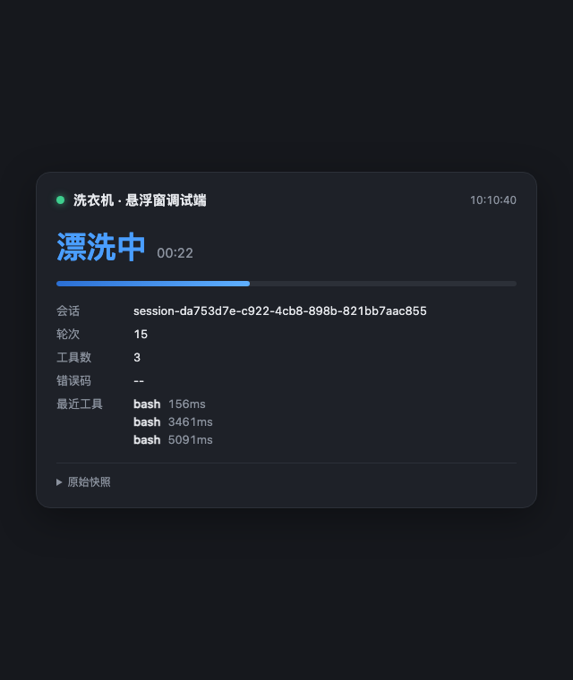
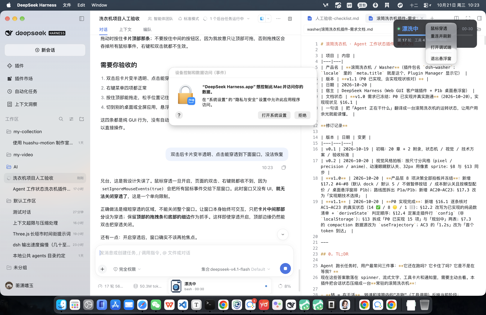

# dsh-washer · 滚筒洗衣机

用一台**滚筒洗衣机**的运转状态，实时显示 DeepSeek Harness 里 Agent 在干什么。

不是装饰：洗衣机的每一个动作都对应一个**可验证**的宿主信号。洗涤 = 模型在出字，漂洗 = 工具在跑，脱水 = 收尾，暂停 = 在等你批准。

```
待机     ▁▁▁▁▁▁▁▁ 筒空、灯暗
注水     ●●●○○○○○ 启动、水位上升
洗涤     ●●●●●●●● 滚筒慢转、气泡翻滚、模型在出字
漂洗     ●●●●●●○○ 反转、工具在跑（卡片里显示工具名）
脱水     ○○●●●○○○ 高速抖动、模糊、收尾
等你     ◐◐◐◐◐◐◐◐ 灯闪琥珀色、盯着你（等你批准/回答）
排水     ▁▁▁▁▁▁▁▁ 换水、水位降到底（上下文压缩中）
洗完了   ✓✓✓✓✓✓✓✓ 绿灯、停 6 秒后回待机
故障     ✕✕✕✕✕✕✕✕ 红灯快闪 + E 码
```

## 状态映射

| 状态 | 洗衣机在做什么 | 触发条件（宿主信号） |
|---|---|---|
| `idle` | 待机，筒空 | 会话存在但没在跑 |
| `starting` | 注水、筒开始转 | `running` 且本轮**还没有任何节点**（模型在出第一个字） |
| `washing` | 洗涤，泡多水满 | `running` 且正在流式出字（`partial` 非空），或上一步是工具 |
| `rinsing` | 漂洗，反转 | `running` 且有工具在跑（`runningCalls` 非空），卡片显示最后一个工具名 |
| `spinning` | 脱水，高速抖动 | `running` 且无工具无流式，本轮最后一个节点是模型输出（收尾） |
| `waiting` | 暂停，灯闪琥珀 | `sessionStatus.pendingInteraction` 有值（等批准 / 等回答） |
| `draining` | 排水换水 | 上下文压缩进行中（`useTrajectory` 快照里最后一条 `purpose: 'compaction'` 的 request 状态为 `running`） |
| `done` | 洗完了 | 本轮正常结束，停 `doneHoldMs` 后自动回 `idle` |
| `error` | 故障 | `turn-error` 节点、或**本轮最后一条**工具 `isError`（失败后自愈重试成功不报故障） |
| `off` | 关机 | 会话被移除 / 不可用 |

错误码：`E-10` 模型/账号、`E-20` 工具失败、`E-21` 审批被拒、`E-30` 上下文/长度、`E-40` 中断、`E-50` 策略拦截、`E-00` 未知。

> 只认**本轮最后一条**节点的成败：Agent 工具失败后自己重试成功，不报故障——避免假警报。

## 三档密度

| 档位 | 尺寸 | 内容 |
|---|---|---|
| `S` | 322×52 停靠条 | 32px 像素 sprite + 一行状态 + 计时 |
| `M` | 322×206 卡片 | 96px 精密家电 + 状态/工具流水 |
| `L` | 322×343 卡片 | 176px 大机器 + 工具流水 + token/耗时/成本 |

造型（`skin`）只有两套：**像素风**（`'pixel'`，默认）和**精密家电**（`'precision'`）。原有的动漫风已删除。

点停靠条展开 / 收起。

## 安装

```bash
# 从 npm 安装（推荐）
dsh plugin --profile desktop add @lyx0717/dsh-washer

# 或者从 GitHub 固定 commit 安装（跟最新发布但可复现）
dsh plugin --profile desktop add github:lyx0717/dsh-washer#<commit>

# 或者本地目录安装（开发用，改完即时生效）
dsh plugin --profile desktop add /path/to/dsh-washer
```

装完在 profile 的 `package.json` 里会多出一条依赖。改完重启 Harness（替换已装包需要重启，新装包由 HMR 接管）。

**卸载**：

```bash
dsh plugin --profile desktop remove @lyx0717/dsh-washer
```

> ### 从 0.2.x（旧包名 `dsh-washer`）升级
>
> 0.3.0 起包名改为 `@lyx0717/dsh-washer`。`cordis.patch.yml` 里防止重复挂载的
> `disabled` 表达式**只认新包名**，所以旧包名和新包名同时装会在两个
> entry 上都挂出 `id: washer`，插件被初始化两次（监听器重复注册、SSE 推送翻倍）。
>
> 升级必须**先卸旧的再装新的**：
>
> ```bash
> dsh plugin --profile desktop remove dsh-washer
> dsh plugin --profile web     remove dsh-washer
> dsh plugin --profile desktop add @lyx0717/dsh-washer
> ```
>
> 偏好文件 `~/.dsh/dsh-washer-float-prefs.json` 和浏览器 `localStorage` 的
> key 都没变，卸载不会丢设置。

## 配置

两条路，互相配合：

1. **默认值**写在 `cordis.patch.yml` 的 `washer` 行 `config:` 下（全部可选，见下表）。
2. **用户改动**在 GUI 里做——展开到 L 档卡片用分段控件切，或打开 **设置 → 洗衣机**。改动存进浏览器 `localStorage`（key `dsh-washer:prefs`），读取顺序是 `内置默认` ← `patch config` ← `localStorage`。

> 为什么不走宿主统一的设置持久化（`ctx.configForms`）：那套 store 只服务挂在 loader `include` 行下的插件，第三方 bundle 走 `- insert:` 拿到的控制器永远是 `unavailable`（写进去读不回来）。已装的 `dsh-better-sidebar` 同样绕开它、自存 `localStorage`。
>
> 代价：桌面悬浮窗读不到浏览器 `localStorage`。浮窗的偏好因此走宿主写到 `~/.dsh/dsh-washer-float-prefs.json` 的文件，并通过 `/dsh-washer/prefs`（JSON 文件）与设置页双向同步——详见下方「悬浮窗（P1b）」。

| 键 | 默认 | 说明 |
|---|---|---|
| `enabled` | `true` | `false` 时完全不挂载（连样式都不注册） |
| `mode` | `'dock'` | `'dock'` 挂在输入框上方；`'overlay'` 挂到 `shell.overlay`（全局浮层） |
| `size` | `'S'` | 初始档位 `'S'` / `'M'` / `'L'` |
| `expandedByDefault` | `false` | 等价于 `size: 'M'`（旧名，保留兼容） |
| `skin` | `'pixel'` | `'pixel'` / `'precision'`（动漫风已删除；老配置里的 `'auto'` 按 `'pixel'` 处理） |
| `skinBySize` | `{xs:pixel, lg:pixel}` | `auto` 模式下尺寸→皮肤（`sm`/`md` 是旧三档时代的残留，已无人使用） |
| `showCost` | `false` | L 档显示成本（需配合 `costPerKToken`） |
| `costPerKToken` | `0` | 每千 token 单价 |
| `costCurrency` | `'CNY'` | `'CNY'` → `¥`，`'USD'` → `$` |
| `hideWhenIdle` | `false` | 待机时整个隐藏 |
| `doneHoldMs` | `6000` | 「洗完了」停留时长 |
| `toolHistoryLimit` | `6` | 工具流水最多显示几条 |

示例：

```yaml
- insert:
    - id: washer
      name: '@lyx0717/dsh-washer'
      config:
        size: 'M'
        skin: 'precision'
        showCost: true
        costPerKToken: 0.004
```

## 设计约束

- **只读**：不往会话里写任何事件，不改其他插件的 DOM。
- **不抢焦点**：停靠条是一个 `<button>`，键盘可达，`:focus-visible` 有描边。
- **尊重动效偏好**：`prefers-reduced-motion: reduce` 时全部动画降到 0.001ms。
- **颜色**：容器/文字走宿主 `--dsw-alias-*` token；只有机身材质用自有 `--dw-*`（暗色由 `[data-ds-dark-theme]` 切换）。
- **零依赖**：不打包 React，直接 `require('react')` 用宿主那一份。

## 开发

```bash
node build.mjs                   # src/ → client.js（内联 core/css/svg，约 128KB）
node --test test/core.test.mjs   # 状态机单测（29 条）
node --test test/host.test.mjs   # 宿主半单测（49 条；会起本地服务，按需手动跑）
node test/render.mjs             # 行为测试（48 条）+ 生成 /tmp/washer-render 截图素材
node debug/e2e.mjs               # 端到端：起真服务 + 模拟事件流，逐行打印状态迁移
```

- `src/core.js` 纯函数状态机，node 下可直接测。
- `src/client.template.js` 组件源码，`build.mjs` 把 core/CSS/SVG 内联成单文件 `client.js`。
- `test/render.mjs` 是最小 React hooks 运行时：真跑 hooks、真 re-render，能测到时间轴行为。
  加 `--no-shots` 只跳过截图写盘，**用例照跑满 48 条**（别在中间 `process.exit()`，
  否则后面的用例没跑也显示通过）。

### ⚠️ 改包名时的唯一硬约束

`src/client.template.js` 第 10 行的模块 id **必须等于 `package.json` 的 `name`**：

```js
window.__ModuleLoader__.load({
  id: '@lyx0717/dsh-washer',   // ← 必须 == package.json 的 name
```

宿主按 `insert.name`（即包名）去 `__ModuleLoader__` 的注册表里查客户端模块。两者不一致时，**查不到的那一边不会报任何错**：服务端半照常工作、日志干净，只是 dock 座位不出现、`settings.section` 不注册——用户在界面上看到的是「插件装了但设置页里连入口都没有」。

`build.mjs` 已加构建期硬断言：模块 id 与包名不符直接构建失败并指出该改哪一行。所以正常情况你改错就会当场发现——**如果看到上面这个症状，先怀疑是不是绕过了构建直接用了旧的 `client.js`。**

改包名时还要同步（`grep -rn "dsh-washer" src/ cordis.patch.yml` 能全部列出来）：

| 位置 | 字段 |
|---|---|
| `package.json` | `name` |
| `cordis.patch.yml` | `insert.name`、`disabled` 表达式里的 `options.name` |
| `src/client.template.js` | `__ModuleLoader__.load` 的 `id`、插件对象的 `name`、各处 `registrant` |

另外，npm 与插件市场是两套东西，别混：

- **npm 包名**改了就是 breaking change，必须**先卸旧包再装新包**——`disabled` 表达式只认新包名，新旧并存会在两个 entry 上都挂 `id: washer`，插件被初始化两次（监听器重复注册、SSE 推送翻倍）。
- **插件市场**（`awesome-dsh-plugin`）那条 `lyx0717__dsh-washer.yml` 的 `url` 字段**只能填 GitHub 仓库地址**，不要改成 npm 链接。npm 源是官方 CI 的 `probe-npm.mjs` 自动探测的：它读仓库根 `package.json` 的 `name`，再核对 npm 上该包的 `repository.url` 是否指回同一个 GitHub 仓库。所以只要 `name` 和 `repository` 都对，不用提 PR 改任何东西，等流水线跑一轮即可。

### 发布到插件市场

改代码 → 刷新索引 → push，一步别少：`node scripts/refresh-market.mjs && git add docs/index.json && git commit -m "docs: 刷新市场索引" && git push`（索引钉当前 commit/版本，push 到 `main` 后 GitHub Pages 自动更新；pre-push 钩子会在"代码变了但索引没刷"时拦下并自动重写 `docs/index.json`）。

### 宿主半（`index.js`）：P1b 数据管道

Web 端的 `deriveState` 吃的是宿主渲染进程里的投影，独立的桌面窗口（Electron）拿不到那些东西。所以宿主半在 Node 侧监听同一批事件、喂给**同一个** `src/core.js`，再通过本地 HTTP+WS 把快照推出去——两边判定只有一份实现，不会各写一套然后对不上。

```yaml
desktopOverlay: false        # 默认关；开了才占端口
desktopOverlayPort: 0        # 0 = 系统分配，日志里打印实际地址
```

- 只绑 `127.0.0.1`，每次启动生成随机 token，`/dsh-washer/state`、`/dsh-washer/health`、`WS /dsh-washer/stream` 全部要 token（query 或 Bearer）。
- 启动后端点信息写到 `~/.dsh/dsh-washer-overlay.json`（0600，进程退出即删），里面有现成的 `url`：

  ```json
  { "url": "http://127.0.0.1:61491/dsh-washer/state?token=...",
    "port": 61491, "token": "...", "pid": 68298 }
  ```

- 调试端：`debug/overlay.html?port=端口&token=令牌`，浏览器直接打开就能看状态流转，断线会自动指数退避重连。

  

## 悬浮窗（P1b）

除了 Web GUI 里的洗衣机，还有一个独立的桌面悬浮窗，常驻屏幕角落看 Agent 在干什么。

```bash
./electron/start.sh
```

- 透明无边框、置顶、跨 Space 可见、不抢焦点
- 按住卡片顶部可拖动，位置退出后记住
- **双击**卡片切换鼠标穿透（穿透时半透明，点击落到下面应用）
- **右键**弹出菜单：穿透开关 / 重连刷新 / 打开调试端 / 退出
- 穿透状态下窗口收不到任何鼠标事件，用 **⌥⌘W** 关闭穿透（不要用 ⌘⇧W，那是系统关窗口的键）

> 从 DSH 的终端里启动时，`ELECTRON_RUN_AS_NODE=1` 会被继承，Electron 会退化成纯 Node。
> `start.sh` 已经帮你清掉了。



- 两个必须守住的点，都有回归测试：**工具返回后不能还停在 rinsing**（状态撒谎比不显示更糟）；**`step/*` 不能进节点序列**——`deriveState` 用「最后一个节点是不是产出类节点」判断走到哪，`step-*` 不在白名单里，混进去会让状态从 washing 倒退成 starting。

### 调试：插件"不见了"先看这里

- **新会话里本来就不显示**。`sessionId` 为空时组件按设计返回 `null`——先打开一个会话再看。
- 判断是不是加载失败：页面若无「启动失败」卡片，说明所有 entry 都激活成功（宿主 `bZ()` 审计会在有失败时抛 `web boot: N entries did not activate` 并渲染卡片）。
- 两条激活通道别混：装进 profile 的 bundle 由启动时的 `manifest.plugins → entries.start → loader.create` 自动激活（本插件走这条）；`cordis-host-runner` 那套只服务模型用 `cordis_define` 现写的动态插件。
- 替换已装包要重启宿主；新装包可被 HMR 接管。

## 许可

MIT。图标与像素 sprite 均为原创（脚本生成，见 `src/machine.svg`、`src/sprite.svg`）。
